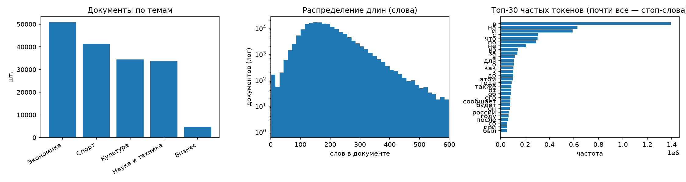
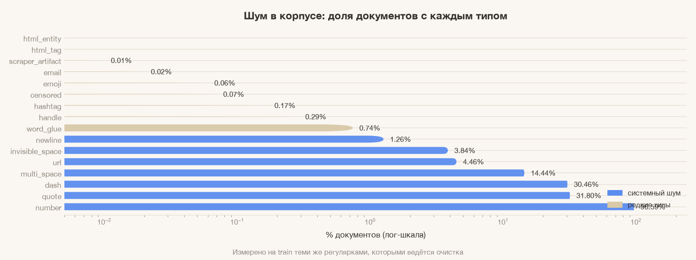
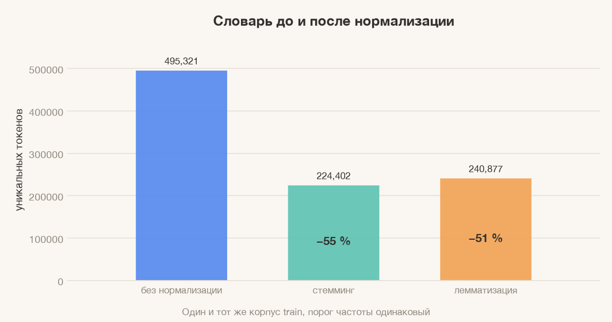
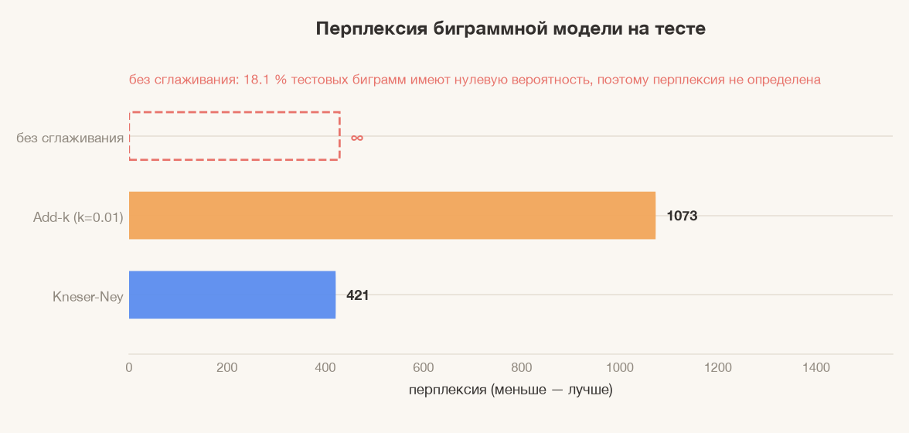

# Лабораторная работа №1 — отчёт

**Тема:** низкоуровневый анализ, предобработка текста и статистическое языковое
моделирование.

**Датасет:** Lenta.ru News Dataset, компактная версия на 5 тем (206 429 статей,
скачана с Hugging Face, подробности — в `../README.md`).

**Код:** `run.py` (сценарий) + `../src/textkit/` (переиспользуемые модули:
`dataset.py`, `cleaning.py`, `normalize.py`, `levenshtein.py`, `lm.py`).
Модули лежат отдельно, потому что очистка и токенизация нужны в лабах 2–4.

**Артефакты:** `artifacts/` — график EDA, таблица шума, очищенный корпус
(`clean_train.parquet`, `clean_test.parquet`), токенизированные корпуса,
`metrics.json` со всеми числами этого отчёта, `trigram_metrics.json` (сравнение
N = 2 и N = 3), `run.log` с замерами времени.

---

## 1. Данные и разбиение

Исходный корпус: 206 429 документов после удаления дублей по тексту и пустых
записей. Разбиение 80/20 со стратификацией по теме, `random_state=42`:

| Выборка | Документов |
|---|---|
| train | 165 143 |
| test | 41 286 |

| Тема | train | доля |
|---|---|---|
| Экономика | 50 833 | 30.8 % |
| Спорт | 41 339 | 25.0 % |
| Культура | 34 448 | 20.9 % |
| Наука и техника | 33 778 | 20.5 % |
| Бизнес | 4 745 | 2.9 % |

Дисбаланс 10.7 : 1. Стратификация сохраняет его в обеих выборках намеренно:
искусственно балансировать классы на этапе EDA нельзя, иначе выводы о корпусе
перестанут быть верными. С балансировкой работаем только в лабе 3, где это
требуется для обучения классификатора.

## 2. Разведочный анализ (только train)

| Метрика | Значение |
|---|---|
| Документов | 165 143 |
| Слов в среднем / медиана | 181.4 / 171 |
| Символов в среднем / медиана | 1325 / 1244 |
| p90 слов | 264 |
| Максимум | 1139 слов / 9191 символ |
| Всего слов | 29 951 838 |

Распределение длин правоскошенное: хвост до 1139 слов, поэтому на графике
использована логарифмическая шкала по оси Y — иначе гистограмма вырождается в
один столбец у нуля.

Доля стоп-слов в токенах — **22.7 %**. График (`artifacts/fig_eda.png`,
третья панель) показывает топ-30 токенов: «в» (1.39 млн), «на» (629 тыс.),
«и» (589 тыс.), «с», «что», «по». Это ожидаемо для новостей: служебные слова
занимают пятую часть корпуса, но не несут тематической нагрузки, поэтому в
лабе 3 они уйдут в `stop_words`, а в языковой модели останутся — там они нужны
для синтаксической связности.

<p align="center"></p>

## 3. Шум в данных

Шум измерен на train теми же регулярками, которыми потом чистится, — иначе
таблица «сколько нашлось» и таблица «что удалили» могут разойтись. Всего
16 типов:

| Тип шума | Документов | Доля | Как обработан |
|---|---|---|---|
| Числа | 159 512 | 96.59 % | → `[NUM]` |
| Кавычки-ёлочки | 52 512 | 31.80 % | → `"` |
| Тире – — | 50 300 | 30.46 % | → `-` |
| Лишние пробелы | 23 848 | 14.44 % | схлопнуты |
| URL | 7 366 | 4.46 % | → `[URL]` |
| Невидимые символы (NBSP, zero-width) | 6 346 | 3.84 % | → пробел |
| Переносы строк | 2 082 | 1.26 % | → пробел |
| @упоминания | 478 | 0.29 % | → `[HANDLE]` |
| Хэштеги | 288 | 0.17 % | → `[HASHTAG]` |
| Цензурные `***` | 121 | 0.07 % | удалены |
| Эмодзи | 105 | 0.06 % | удалены |
| E-mail | 38 | 0.02 % | → `[EMAIL]` |
| Артефакты скрейпера (`RedirectTo`) | 10 | 0.01 % | удалены |
| HTML-теги | 2 | ≈0 % | удалены |
| HTML-сущности | 0 | 0 % | — |
| Hex-коды | 0 | 0 % | — |

<p align="center"></p>

**Вывод по шуму.** Lenta — профессионально отредактированные новости, поэтому
«интернет-мусора» (HTML, эмодзи, ники) в ней почти нет: 0.02 % HTML и 0.29 %
упоминаний. Утверждать, что шума нет совсем, нельзя — есть три систематических
дефекта, которые реально влияют на анализ:

1. **Неразрывные пробелы и zero-width символы** (3.8 % документов). Они ломают
   наивный `split()` и создают «невидимые» токены-двойники: слово, набранное
   с NBSP, не совпадёт со словом с обычным пробелом. Это самый опасный тип
   шума для словаря.
2. **Кавычки двух видов** (« » и " ") и **тире трёх видов** (– — -). Если их не
   нормализовать, в словаре появятся разные варианты одной сущности.
3. **Артефакты скрейпинга** — обрывки вида `.RedirectTo http://...`, попавшие в
   текст при выгрузке.

Требование «нельзя просто оставить буквы» выполнено: числа, ссылки, адреса и
упоминания не удаляются, а заменяются типизированными токенами, поэтому модель
может выучить, что `[NUM]` после слова «рублей» — это сумма, а `[URL]` —
источник. Пунктуация сохраняется на этапе очистки и отбрасывается только при
токенизации, где она действительно не нужна.

Пример работы конвейера:

```
до:    ... 6-летний Бруклин попросил Бекхэма помочь ему с уроками, но игрок
        мадридского "Реала" был поставлен заданием в тупик
после: ... [NUM] -летний Бруклин попросил Бекхэма помочь ему с уроками, но игрок
        мадридского "Реала" был поставлен заданием в тупик
```

К каждому документу добавлены `<s>` и `</s>` — они нужны языковой модели как
маркеры начала и конца последовательности.

## 4. Стемминг и лемматизация

Оба метода применены к одному и тому же набору токенов обучающей выборки
(30.3 млн токенов), порог частоты одинаковый.

| Вариант | Уникальных форм | Доля от исходного | Что получается |
|---|---|---|---|
| Без нормализации | 495 321 | 100 % | «года», «году», «годы», «Года» — разные единицы |
| Стемминг (Snowball) | 224 402 | **45.3 %** | «кошками» → «кошк», «бежали» → «бежа» |
| Лемматизация (pymorphy3) | 240 877 | **48.6 %** | «кошками» → «кошка», «бежали» → «бежать» |

<p align="center"></p>

Стемминг даёт словарь на 6.8 % меньше лемматизации, но за счёт «склеивания»
разных слов: усечение суффиксов не различает части речи и может свести
«бежать» и «бег» к разным, а «стол» и «столовая» — к близким основам.
Лемматизация даёт осмысленные словарные единицы, но зависит от качества
разбора: для незнакомых слов и аббревиатур pymorphy3 угадывает разбор.

**Вывод для этого корпуса.** Новости — тексты с богатой морфологией, но
предсказуемой лексикой, поэтому для лаб 2–3 (POS-теги, темы, поиск) выгоднее
лемматизация: она сохраняет различие частей речи, важное для синтаксического
анализа. Стемминг уместен там, где нужен максимально компактный словарь и
скорость (например, инвертированный индекс в поиске, где лемматизация тоже
сгодится, но дороже).

Скорость: 8 процессов, 59 секунд на 30 млн токенов благодаря кешу
«слово → форма» (в корпусе 495 тыс. типов против 30 млн токенов, то есть
каждый разбор в среднем переиспользуется 60 раз).

## 5. Расстояние Левенштейна

### Реализация

`src/textkit/levenshtein.py`, функция `levenshtein(a, b, max_dist)`. Классическая
динамика по матрице заменена двумя строками: для перехода нужны только
предыдущая и текущая строки, поэтому память `O(min(|a|, |b|))` вместо `O(|a||b|)`.
Дополнительно есть ранний выход: если минимальное значение в текущей строке уже
превышает `max_dist`, расстояние точно больше порога и считать дальше незачем.

### Почему нельзя перебрать все пары

Словарь после фильтра (частота ≥ 10, длина ≥ 4) — 111 602 слова. Полный перебор
пар — это 6.2 млрд сравнений, что невыполнимо. Поэтому пары-кандидаты
отбираются фильтром q-грамм: если строки отличаются не более чем на `k` правок,
то из `k + 1` самых редких триграмм хотя бы одна уцелеет. Значит, достаточно
опросить три самых редких триграммы слова — их списки вхождений короткие — и
проверить у кандидатов число общих триграмм. Точное расстояние считается только
для прошедших фильтр.

Результат: **537 822 пары** на расстоянии 1–2 (113 606 на расстоянии 1,
424 216 на расстоянии 2) за 143 секунды — на три порядка меньше полного
перебора.

### Почему «топ-10 по частоте» бесполезен

Первая версия сортировала пары по суммарной частоте, и верх списка заняли
«года/году/годы/годах». Это не опечатки, а словоформы: в русском почти любые
две формы одного слова отличаются на 1–2 правки. Более того, похожие строки
часто оказываются разными словами. Поэтому пары разделены на три класса.

**Словоформы** (одна лемма, обе частоты ≥ 1000):

| a | b | d | частота |
|---|---|---|---|
| года | году | 1 | 273 290 |
| года | годы | 1 | 179 155 |
| года | годах | 1 | 177 736 |
| года | годов | 2 | 175 499 |
| этом | этого | 2 | 135 174 |
| россии | россия | 1 | 111 365 |

**Ложные срабатывания** (разные леммы, обе частоты высокие) — ровно то, что
метрика не умеет различать и что важно показать:

| a | b | d | частота |
|---|---|---|---|
| года | города | 2 | 176 399 |
| года | подал | 2 | 173 181 |
| года | рода | 1 | 172 663 |
| этом | этот | 1 | 121 662 |
| также | таким | 2 | 104 388 |

**Опечатки-кандидаты** — редкое слово (частота ≥ 2, не более 5 % от частоты
частого) **неизвестно морфологическому словарю** pymorphy3, а частое — известно.
Именно словарная проверка отсекает редкие, но настоящие слова («ирод», «сход»):

| Редкое | Похоже на | d | Частота редкого / частого |
|---|---|---|---|
| тода | года | 1 | 11 / 171 348 |
| уэстом | этом | 2 | 32 / 103 636 |
| годо | году | 1 | 16 / 101 942 |
| россо | россии | 2 | 22 / 96 606 |
| такис | также | 2 | 11 / 90 685 |
| сообщаетcя | сообщает | 2 | 18 / 80 176 |
| уден | будет | 2 | 16 / 78 679 |
| доллларов | долларов | 1 | 11 / 75 187 |
| мосли | после | 2 | 104 / 62 299 |
| фремо | время | 2 | 17 / 55 340 |

Здесь видны настоящие дефекты: «доллларов» (удвоение), «сообщаетcя» — латинская
`c` вместо кириллической `с`, «такис» вместо «также». Остальные — обрывки
скрейпинга или опечатки на одну букву.

### Вывод

Строковые метрики сами по себе не решают задачу поиска опечаток в
морфологически богатом языке: из 537 822 пар подавляющее большинство — либо
словоформы, либо разные настоящие слова. Рабочая схема требует трёх
дополнительных сигналов: **частотного** (редкое против частого), **морфологического**
(лемма должна различаться) и **словарного** (редкое слово должно отсутствовать
в словаре). После них остаётся около 10 тыс. кандидатов, из которых верх списка
уже содержательно полезен.

## 6. Языковая модель

### Построение

Биграммная модель (N = 2) — основная модель отчёта. Триграмма на тех же 30 млн
токенов проверена отдельно (см. «Проверка N = 3» ниже): она снижает перплексию,
но требует в 2.2 раза больше типов и корректного backoff-сглаживания. Для
основной модели выбран N = 2: разреженность меньше, сравнение сглаживаний
нагляднее, а генерация остаётся интерпретируемой.

* словарь — 298 610 типов (порог частоты 2);
* биграммных типов — 7 980 627;
* всего биграмм в обучении — 30 434 751;
* OOV-слова теста заменяются на `[UNK]`; частота `[UNK]` собирается из всех
  выброшенных слов, иначе вероятность неизвестного слова занижается.

### Сглаживание

**Add-k** (вариант Лапласа):

$$P(w_i \mid w_{i-1}) = \frac{c(w_{i-1}, w_i) + k}{c(w_{i-1}) + k|V|}, \quad k = 0.01$$

**Kneser-Ney** с абсолютным дисконтированием $D$:

$$P_{KN}(w_i \mid w_{i-1}) =
\frac{\max(c(w_{i-1}, w_i) - D,\ 0)}{c(w_{i-1})}
+ \frac{D \cdot N_{1+}(w_{i-1}\bullet)}{c(w_{i-1})} \cdot P_{cont}(w_i)$$

$$D = \frac{n_1}{n_1 + 2n_2} = 0.739, \qquad
P_{cont}(w) = \frac{N_{1+}(\bullet w)}{\sum_{v} N_{1+}(\bullet v)}$$

где $n_1, n_2$ — число биграмм с частотой 1 и 2, $N_{1+}(\bullet w)$ — число
различных левых контекстов слова, $N_{1+}(w\bullet)$ — число различных правых.
Kneser-Ney предпочтительнее аддитивного сглаживания, потому что дисконтирует
наблюдаемые биграммы пропорционально и распределяет освободившуюся массу по
контекстам, где слово действительно может появиться, а не по всему словарю
равномерно.

### Перплексия

$$PP = \exp\left(-\frac{1}{N}\sum_{i=1}^{N} \ln P(w_i \mid w_{i-1})\right)$$

Сумма логарифмов вместо произведения вероятностей: произведение 30 млн чисел
порядка $10^{-3}$ уходит в машинный ноль.

| Модель | Перплексия на test |
|---|---|
| Без сглаживания | **∞** — 18.1 % тестовых биграмм имеют нулевую вероятность |
| Add-k (k = 0.01) | 1073.2 |
| Kneser-Ney | **421.3** |

<p align="center"></p>

Доля невиденных биграмм в тесте — 18.12 %. Именно она математически обосновывает
необходимость сглаживания: без него вероятность хотя бы одной биграммы равна
нулю, а значит, равна нулю вероятность всего документа, и перплексия
не определена. Add-k снижает «катастрофу» ценой размазывания вероятности по
всем 298 тыс. типов словаря — отсюда перплексия в 2.5 раза выше, чем у
Kneser-Ney, который отдаёт освободившуюся массу только правдоподобным
продолжениям.

### Проверка N = 3: что даёт триграмма

Основная модель отчёта биграммная, но на защите ожидаемо спрашивают, что
изменилось бы при N = 3. Чтобы ответить числом, а не оценкой, отдельный скрипт
`../sandbox/lab1_trigram.py` обучил обе модели на тех же токенах, с тем же
словарём (порог частоты 2) и теми же двумя сглаживаниями. Биграммные значения
воспроизвелись один в один (421.34 и 1073.24), поэтому сравнению можно доверять.
Перплексия нормируется на число предсказанных токенов; у триграммы на один
токен в начале каждого документа меньше (при средней длине 181 слово это
меньше 1 %), поэтому числа сопоставимы. Реализация упрощённая: невиденные
триграммы откатываются к биграммной Kneser-Ney, а не к отдельной
continuation-модели младшего порядка — для сравнения N = 2 и N = 3 этого
достаточно, но абсолютное значение может немного отличаться от «канонической»
реализации.

| Модель | Перплексия на test | Невиденных n-грамм |
|---|---|---|
| Биграмма, Add-k | 1073.2 | 18.1 % |
| Биграмма, Kneser-Ney | 421.3 | 18.1 % |
| Триграмма, Add-k | 9007.9 | 49.6 % |
| Триграмма, Kneser-Ney | **248.9** | 49.6 % |

Триграммных типов — 17 749 215 против 7 980 627 биграммных (в 2.2 раза больше),
из них 15 064 585 (84.9 %) встречаются в обучении ровно один раз; дисконт
D₃ = 0.838 против D₂ = 0.739.

Что из этого следует:

1. **С корректным сглаживанием N = 3 действительно лучше.** Перплексия падает
   с 421.3 до 248.9, то есть на 41 %: два слова контекста дают более узкое
   распределение, и там, где триграмма наблюдалась, модель увереннее.
2. **Выигрыш оплачен разреженностью.** Почти половина тестовых триграмм
   (49.6 % против 18.1 % у биграмм) в обучении не встречалась. Для половины
   тестовых токенов у триграммы просто нет собственной оценки, поэтому заметная
   часть улучшения — это работа backoff к биграммной Kneser-Ney, а не
   триграммных счётчиков.
3. **Add-k с ростом N разваливается.** 9007.9 против 1073.2 у биграммы —
   в 8.4 раза хуже. При 49.6 % невиденных n-грамм аддитивное сглаживание
   размазывает массу по всем 298 610 типам словаря, и предсказания для
   невиденных и редких контекстов получают вероятность порядка 1/|V|. Чем выше
   порядок модели, тем важнее сглаживание, умеющее откатываться к младшему
   контексту.
4. **Цена — память.** 17.7 млн триграммных типов и пик RSS 3.5 ГБ; обучение
   обеих моделей и четыре оценки заняли 159 секунд, тогда как биграммная модель
   в основном прогоне обучается за 36.6 секунды. Для 30 млн токенов это
   приемлемо, но на полном корпусе (144 млн токенов) триграммные счётчики
   упрутся в память раньше, чем дадут выигрыш.

**Решение.** Основной моделью остаётся N = 2: она компактна, её сглаживания
наглядны, и на ней построена генерация. Триграмма с интерполированным
Kneser-Ney — законный способ снизить перплексию на 41 %, если качество важнее
памяти; Add-k в этом режиме непригоден. Общий вывод: рост N помогает только
вместе с backoff-сглаживанием, иначе разреженность съедает весь эффект.

## 7. Генерация

Пять текстов, старт с `<s>`, остановка на `</s>` или 40 токенах. Температура
меняет «остроту» распределения: чем выше, тем больше редких слов.

**T = 0.5** (осторожная выборка):
> телефонов кроме того армий роналду попугай совершил участвовавший в элизий
> почета закона заря если поставил романтики сборов ходом в составит [NUM] первый
> колоссальная голы подразделение михаэль королевой с боевым для уменьшением
> мафиози игнатенко денежный приз турции замечательный group braid памятник

**T = 0.8**:
> в перспективе нет такаши мураками технологий и с бежали у роснефти парк
> образованы льдом в конце сезона [NUM] года и с [NUM] июня на [NUM] года будет
> проводить со ссылкой на орбиту ежегодно нарядах в составе создавался сообщает в
> пятницу

**T = 0.8**:
> некрасова александр овечкин череповецкую северсталь кроме того [NUM] миллиарда
> рублей при этом сообщил паралимпийцев или другой стороны не принято на уровне
> методам ставки по словам тренера армейцев перейти в срок заполнить радаров t
> спикеры обещают сотрудничать с несколькими стрелу root

**T = 1.0**:
> по истории национальной валюты который состоится [NUM] гигаватта

**T = 1.2** (хаотичная):
> [NUM] года поэтому я не станет обходить школах гетто и осталась без помощи
> инструментов экспериментальной антимонопольщиков в будущем пока информации досуг
> гитарист покинул стадион зенит полузащитники марек янкуловски ddg [NUM] миллиона
> большинство основных летательных аппаратах вышедших на второе место в

**Оценка.** Локальная связность на уровне 2–4 слов есть: «в конце сезона»,
«[NUM] миллиарда рублей», «по словам тренера», «на второе место в». Грамматика
на уровне предложения распадается почти сразу — модель не знает согласования,
падежного управления и не удерживает тему. Видно и характерное для новостей:
модель охотно ставит `[NUM]` и названия организаций, потому что это самые
частотные продолжения. При росте температуры появляется мусор из латиницы
(`ddg`, `root`, `group braid`) — это реальные токены корпуса, вытесненные из
вероятностного ядра. Текст при T = 1.0 оборвался на `</s>` после 9 токенов —
модель уверенно предсказала конец, что тоже показывает силу биграммного
контекста: после «который состоится [NUM] гигаватта» продолжение статистически
маловероятно.

Именно этот разрыв между локальной и глобальной связностью — аргумент в пользу
нейросетевых моделей в лабе 4.

## 8. Что важно знать при защите

* **Почему N = 2?** Основная модель компактна и наглядна, а генерация на ней
  интерпретируема. Проверка N = 3 (`../sandbox/lab1_trigram.py`) показывает, что
  триграмма с интерполированным Kneser-Ney снижает перплексию с 421.3 до 248.9
  (−41 %), но 49.6 % тестовых триграмм невиденные, типов становится 17.7 млн
  против 8.0 млн, а пик памяти — 3.5 ГБ; Add-k на триграммах даёт 9007.9.
  То есть N = 3 оправдан только с backoff-сглаживанием и ценой памяти.
* **Почему `[UNK]` собирается из выброшенных слов?** Иначе вероятность
  неизвестного слова равна вероятности самого редкого типа, и перплексия на
  тесте завышается.
* **Почему перплексия Add-k выше?** Он размазывает массу равномерно по всему
  словарю, включая слова, которые после данного контекста не встречаются
  никогда.
* **Ограничения работы:** биграммы не моделируют дальний контекст; пунктуация
  отброшена; `[NUM]` склеивает все числа, включая годы и деньги; корпус — только
  5 тем из 23 в полной версии.

## 9. Воспроизведение

```bash
cd danila-kurz
python lab1/run.py

# разовое сравнение N = 2 и N = 3 (~2.6 минуты, пик памяти ~3.5 ГБ)
python sandbox/lab1_trigram.py
```

Полный прогон — около 6 минут (очистка кешируется, повторный запуск ~5 минут).
Сравнение N = 2 и N = 3 пишет результат в `artifacts/trigram_metrics.json`.
Версии библиотек зафиксированы в `../requirements.txt`. Замеры времени по шагам
печатаются в консоль и сохраняются в `artifacts/run.log`.
